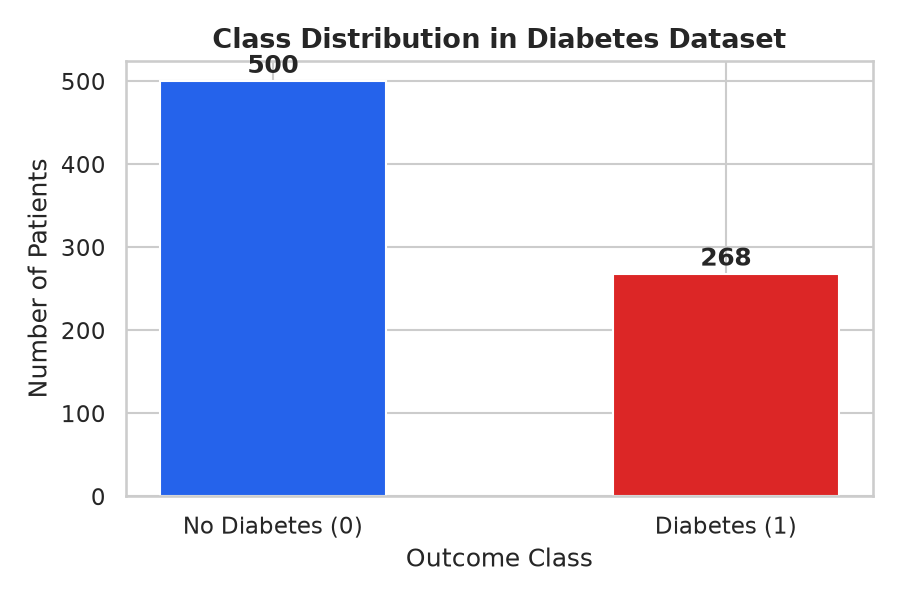
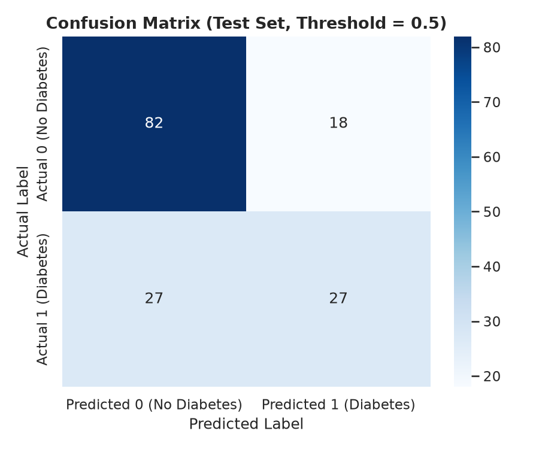
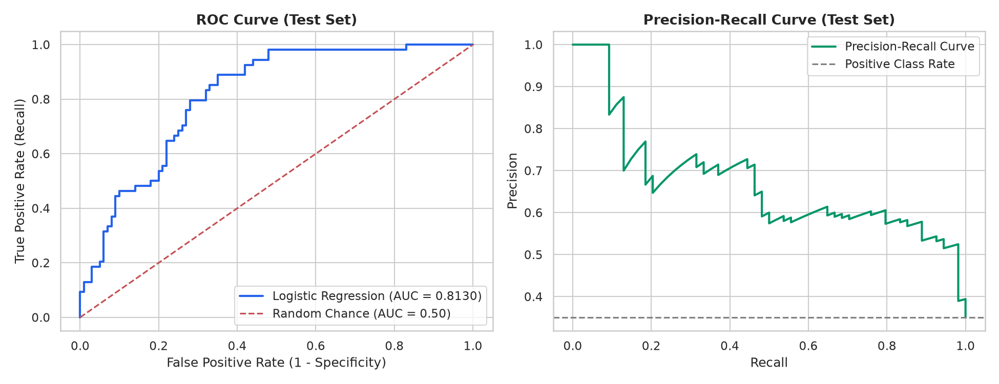
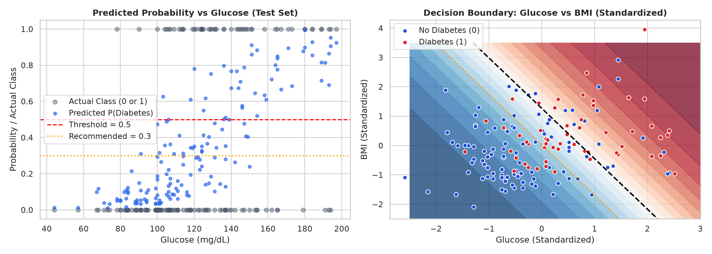

# RCA CIE 2 Activity 2: Binary Classification (Logistic Regression)

**Student Name:** Dhruv Gosavi  
**Roll No.:** AD3162 | **Division:** A  
**Subject:** Regression and Classification Algorithms (RCA) — CIE 2 Activity 2 (Unit II)  
**Department:** AI & DS (T.Y. B.Tech)  
**Faculty GitHub:** https://github.com/complexiota  
**Repository:** https://github.com/dhruv-000/RCA-CIE2-Activity2-Binary-Classification

---

## Project Overview

This project implements **Binary Classification using Logistic Regression** on the Pima Indians Diabetes dataset for CIE 2 Activity 2. It covers data inspection, handling invalid medical zero values without data leakage, stratified 80:20 train-test splitting, feature scaling, sigmoid probability intuition, model evaluation (Confusion Matrix, Accuracy, Precision, Recall, Specificity, F1-score, ROC-AUC), majority-class baseline comparison, threshold tuning (`0.3`, `0.5`, `0.7`), decision-behaviour visualization, and predicting on a new patient record.

## Problem Statement

For a community health-screening programme, the goal is to predict whether a patient has diabetes (`Outcome = 1`) or does not have diabetes (`Outcome = 0`) using 8 numerical medical measurements:
`Pregnancies`, `Glucose`, `BloodPressure`, `SkinThickness`, `Insulin`, `BMI`, `DiabetesPedigreeFunction`, and `Age`.

## Dataset Description and Source

- **Dataset:** Pima Indians Diabetes Database
- **Source:** [Kaggle — Pima Indians Diabetes Database (UCI)](https://www.kaggle.com/datasets/uciml/pima-indians-diabetes-database)
- **Size:** `768` rows × `9` columns (`data/diabetes.csv`)
- **Class Distribution:** `500` Negative (`0` — `65.10%`), `268` Positive (`1` — `34.90%`)
- **Cleaning:** Impossible `0` values in `Glucose`, `BloodPressure`, `SkinThickness`, `Insulin`, and `BMI` were replaced with `NaN` and imputed using the **training-set median** after splitting.

## Project Structure

```text
RCA-CIE2-Activity2-Binary-Classification/
│
├── data/
│   └── diabetes.csv
├── notebooks/
│   └── Activity2_Binary_Classification.ipynb
├── outputs/
│   └── generated_visualizations/
├── README.md
└── requirements.txt
```

## Evaluation Results (Test Set, `n = 154`)

- **Majority-Class Baseline Accuracy (always predict `0`):** `64.94%` (`Recall = 0.0000`)
- **Confusion Matrix at `0.5` threshold:** `TN = 82`, `FP = 18`, `FN = 27`, `TP = 27`

| Metric | Formula | Test Result (`0.5` Threshold) |
| :--- | :--- | ---: |
| **Accuracy** | `(TP + TN) / (TP + TN + FP + FN)` | `0.7078` |
| **Precision** | `TP / (TP + FP)` | `0.6000` |
| **Recall (Sensitivity)** | `TP / (TP + FN)` | `0.5000` |
| **Specificity** | `TN / (TN + FP)` | `0.8200` |
| **F1-score** | `2 * (Precision * Recall) / (Precision + Recall)` | `0.5455` |
| **ROC-AUC** | Area under ROC curve | `0.8130` |

### Threshold Comparison (`0.3` vs `0.5` vs `0.7`)

| Threshold | Predicted Positive | Accuracy | Precision | Recall | F1-score |
| :---: | :---: | :---: | :---: | :---: | :---: |
| **`0.3` (Recommended)** | `72` | `0.7403` | `0.5972` | `0.7963` | `0.6825` |
| `0.5` (Default) | `45` | `0.7078` | `0.6000` | `0.5000` | `0.5455` |
| `0.7` | `28` | `0.7273` | `0.7143` | `0.3704` | `0.4878` |

**Recommended Threshold:** `0.3` is recommended for initial health screening because Missing a diabetic patient (False Negative) is much riskier than a False Positive follow-up test, and `0.3` improves Recall from `50.00%` to `79.63%` while also increasing Accuracy and F1-score.

### Sample New Patient Prediction
For `Pregnancies=2, Glucose=145, BloodPressure=78, SkinThickness=28, Insulin=130, BMI=32.5, DiabetesPedigreeFunction=0.45, Age=36`:
- **Predicted Probability of Diabetes:** `46.05%` (`0.4605`)
- **Predicted Class:** `0` at `0.5` threshold, **`1` (Diabetes — flagged for follow-up)** at the recommended `0.3` threshold.

## Visualizations

| Class Distribution | Confusion Matrix |
| :---: | :---: |
|  |  |

| ROC & Precision-Recall Curves | Decision Behaviour |
| :---: | :---: |
|  |  |

## How to Run

```bash
git clone https://github.com/dhruv-000/RCA-CIE2-Activity2-Binary-Classification.git
cd RCA-CIE2-Activity2-Binary-Classification
pip install -r requirements.txt
jupyter notebook notebooks/Activity2_Binary_Classification.ipynb
```

## Conclusion

Logistic Regression achieved `0.8130` ROC-AUC on unseen test data and outperformed the majority-class baseline. Lowering the decision threshold to `0.3` substantially improved Recall (`79.63%`) and F1-score (`0.6825`). Predicted probabilities are screening estimates only and should never replace clinical diagnosis by a doctor.
